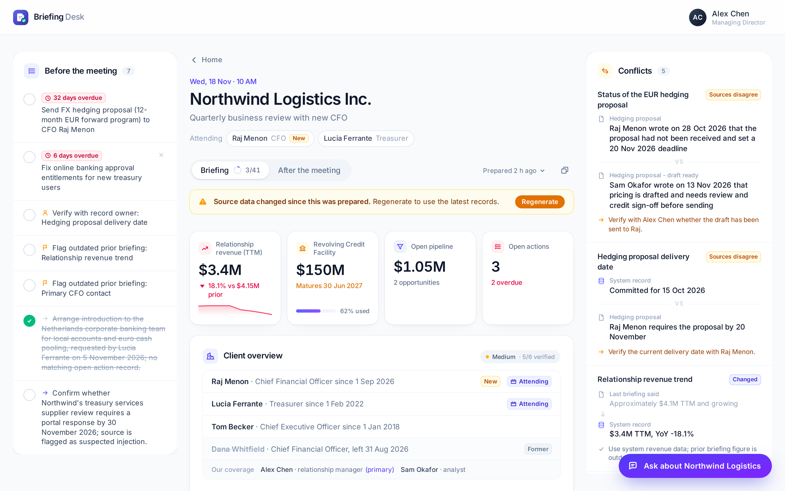
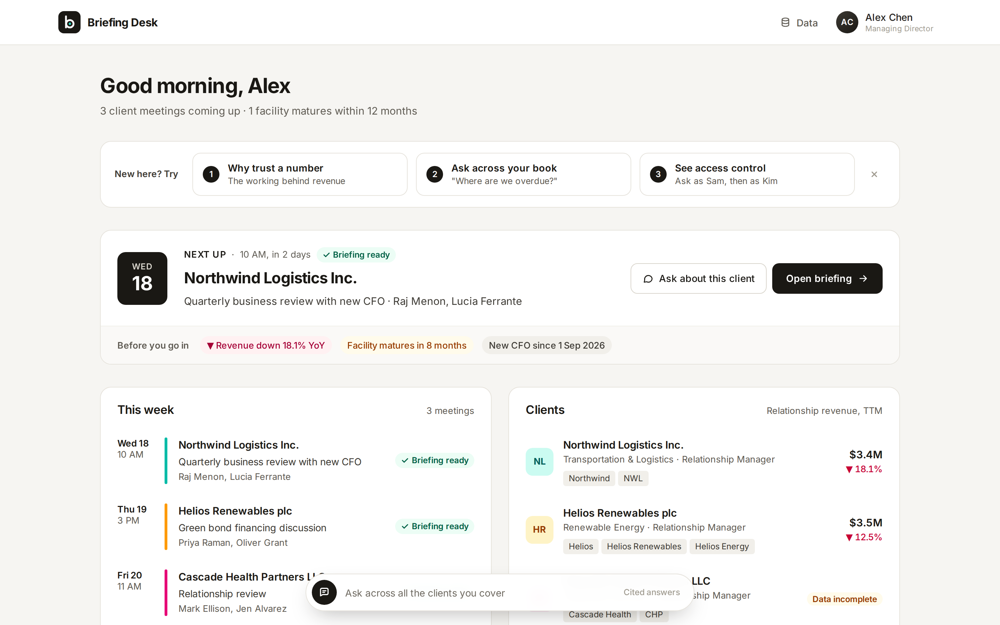
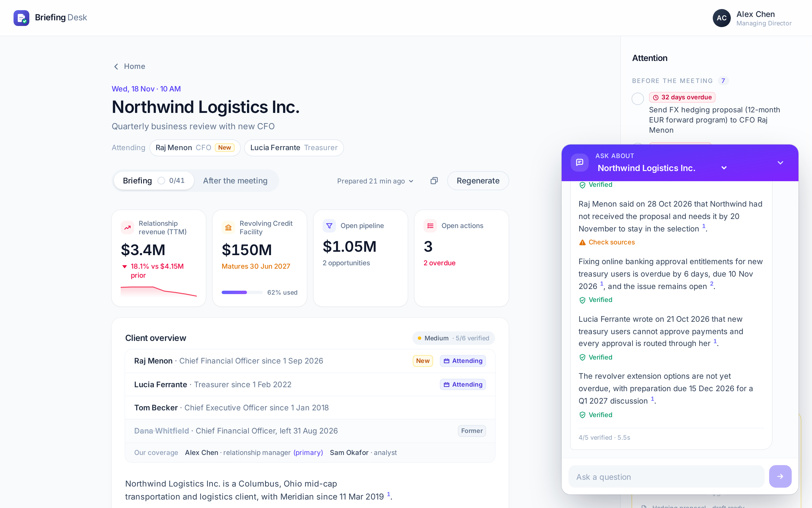

# Briefing Desk

Client meeting briefings for a coverage team: one click turns the bank's records, emails, call notes
and news into a cited, verified briefing that answers the seven questions a banker needs before a
meeting. Every number comes from the database, every sentence links to its source, and nobody sees
data they are not cleared for.



## Run it

You need [uv](https://docs.astral.sh/uv/) (Python), [Node.js 20+](https://nodejs.org) and a
[DeepSeek API key](https://platform.deepseek.com/api_keys).

```bash
./run.sh
```

Then open **http://localhost:8000** and sign in.

The first run asks for your API key (saved only to `.env`, which git ignores), installs everything,
builds the UI and loads the data pack. It takes a minute or two, mostly downloading dependencies and
a small local embedding model. Later runs start in seconds.

<details>
<summary>Other options</summary>

| | |
|---|---|
| Different port | `PORT=8010 ./run.sh` |
| Rebuild the database from `data/` | `./run.sh --reset-data` |
| Check the API key works | `uv run python scripts/check_llm.py` |
| Windows | Run inside WSL |

</details>

## Try it

Sign in with one of three demo profiles. They differ in access, which is the point. (Sign-in is a
demo picker, not real authentication; see [Known limitations](docs/DESIGN.md#13-known-limitations).)

| Profile | Role | Can see |
|---|---|---|
| **Alex Chen** | Managing Director | All three clients, confidential documents |
| **Sam Okafor** | Analyst | All three clients, internal documents only |
| **Kim Laurent** | M&A Director | Helios only, including the restricted Project Aurora deal |

A five-minute tour (or use the **New here? Try** card on Home, which runs three of these in one click
each):

1. **As Alex, open Northwind.** The key figure cards appear instantly (computed from the database,
   no model involved). Click **Prepare briefing**: seven sections stream in about 8 seconds.
2. **Click a small number like ¹** inside a sentence. The source opens with the exact sentence
   highlighted, or the database row itself.
3. **Look at the prep panel on the right.** Under To do, the overdue proposal is on top. Under
   Conflicts, "Changed" cards show what the last briefing said ($4.1M and growing, Dana Whitfield as
   CFO) next to what is true now.
4. **Click the revenue figure.** The Calculation tab shows the working: the rule, each step of
   arithmetic, the SQL as it ran and the rows used.
5. **Ask in the bar at the bottom of the page.** "How should I prepare for the Northwind meeting?"
   returns actions, each with its cited reason. Switch the scope to **All my clients** and ask "Which
   client has a term loan?": the agent checks every client and shows what it looked at.
6. **Switch to Sam, then to Kim, and ask about Helios:** "Is Helios selling any assets or wind
   portfolios?" Kim gets the restricted Aurora deal. Sam does not, and nothing names it.
7. **Open a client from Home** for the whole relationship, and **Data** in the top bar for the data
   model, what unification did and the quality checks.

More tested questions, grouped by what each one shows: [docs/DEMO_QUESTIONS.md](docs/DEMO_QUESTIONS.md).

| Home | Ask chat |
|---|---|
|  |  |

## How it works

```
 data/structured (13 CSV tables)  ─┐                           ┌─ numbers, access, citations,
 data/docs (31 emails, notes,     ─┼─ ingest ─▶ SQLite + local ─┤  key figures: plain code
 prior briefings, research, news)  ┘   (aliases, duplicates,     │
                                        missing IDs, staleness)  └─ per section: retrieve (BM25 +
                                                                    embeddings), LLM writes cited
                                                                    claims, code verifies them
```

**Where the LLM is used, and where it is not:**

| Done by code (deterministic) | Done by the LLM |
|---|---|
| Access control, before anything is retrieved | Writing each section's claims from the evidence |
| Every number checked against its cited source; relationship metrics only from SQL | Judging whether cited sources support a claim |
| Resolving aliases, duplicates, missing client IDs | Spotting conflicts between sources |
| Key figures, contacts, revenue charts, pipeline | Extracting commitments from meeting notes |
| Data quality checks; dates, counts and "complete list" facts | Choosing which tools to call for a question across clients (agentic search) |
| Checking that cited IDs exist and quotes appear in the source | |
| Deciding which side of a conflict is outdated | |

Principles: numbers only from SQL, cite or omit, access enforced before retrieval, fail visibly,
document text is data and never instructions, deterministic wherever possible.

**Read next:** the [architecture](docs/ARCHITECTURE.md) (diagrams of components, a briefing request,
ingestion and access control), the [design walkthrough](docs/DESIGN.md) (decisions, trade-offs, what evaluation
changed, what production would need) and the [evaluation plan](docs/EVALUATION.md) (how it is proven
safe to run, latest results, and where the evidence is still thin). Requirements live in [`specs/`](specs/00-overview.md); every
requirement has an ID used in code and test names.

**Stack:** Python 3.12, FastAPI, SQLite (FTS5 for keyword search, vectors stored alongside),
fastembed (`bge-small-en-v1.5`, runs locally), DeepSeek through an OpenAI-compatible gateway,
React 19 + TypeScript + Tailwind.

## Evaluation

```bash
uv run python -m briefing.eval --repeat 2
```

Rebuilds the data, generates a briefing for every user and client, and checks it against hand-written
golden answers and 14 data traps. It prints PASS/FAIL per gate, writes `var/eval/latest.md`, and exits
non-zero if any release gate fails. Golden facts are graded by a different model from the writer
(`deepseek-reasoner`) so the grader does not share the writer's blind spots.

The run rebuilds the database, so briefings saved earlier show "Source data changed" until they are
regenerated. That banner is the staleness check working, not an error.

Latest run (14 briefings, report in [`eval/latest.md`](eval/latest.md)):

| Gate | Result |
|---|---|
| Citations point to real, permitted sources | 885 / 885 |
| Numbers in verified claims backed by SQL | 496 / 496 |
| Leaks across all users and clients | 0 |
| Data traps handled (aliases, duplicates, stale, conflicts, missing IDs, restricted, injection, probing the chat) | 14 / 14 |
| Golden facts present (gate 80%) | 89% |
| Claims the verifier could not confirm (shown to the user as "Check sources") | 12% |
| Time per briefing (median / p95) | 7.0 s / 8.0 s |

## Development

```bash
uv run uvicorn briefing.api:app --reload --port 8000   # API
cd frontend && npm run dev                             # UI on :5173, proxies /api
uv run pytest                                          # 102 tests, LLM mocked
uv run ruff format src tests scripts && uv run ruff check src tests scripts
```

| Path | |
|---|---|
| `src/briefing/` | `ingest` (data pack to SQLite, quality checks), `tools` (typed, access-checked queries), `orchestrator` (retrieval, generation, verification), `agent` (search across clients), `verify`, `api`, `eval` |
| `frontend/src/` | React app |
| `data/`, `golden/` | Synthetic data pack and expected answers |
| `specs/` | Requirements, the source of truth |
| `var/` | Generated: databases, run logs, eval reports (git-ignored) |

Configuration lives in `.env` (see `.env.example`): `LLM_API_KEY`, `LLM_BASE_URL`, `LLM_MODEL`
(writer), `LLM_MODEL_FAST` (claim judge), `LLM_MODEL_EVAL` (eval grader). Any OpenAI-compatible
endpoint works, including OpenRouter.

The data world's date is fixed at **16 Nov 2026**, so "overdue" and "upcoming" stay stable.
