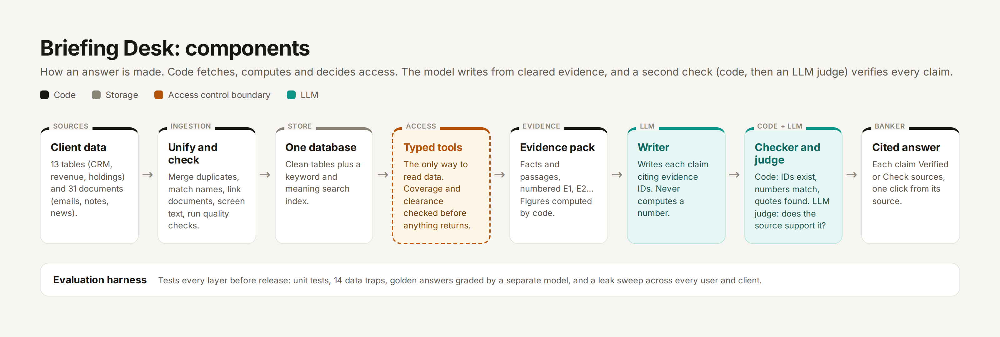

# Briefing Desk

Cited, verified client meeting briefings. Every number comes from the database, every sentence links
to its source, and nobody sees data they are not cleared for.


## Run it

Needs [uv](https://docs.astral.sh/uv/), [Node.js 20+](https://nodejs.org) and a
[DeepSeek API key](https://platform.deepseek.com/api_keys).

```bash
./run.sh          # asks for the key once (saved to .env), then serves http://localhost:8000
```

## Try it

Sign in as one of three demo profiles (a picker, not real authentication). They differ in access.

| Profile | Sees |
|---|---|
| **Alex Chen**, Managing Director | All three clients, confidential documents |
| **Sam Okafor**, Analyst | All three clients, internal documents only |
| **Kim Laurent**, M&A Director | Helios only, including the restricted Project Aurora deal |

Start with the **New here? Try** card on Home. Then:

1. **Open a briefing** and click a small number like ¹ to see its source.
2. **Click a figure** to see its calculation: the rule, the SQL and the rows.
3. **Ask the chat** "Is Helios selling any assets?" as Sam, then as Kim.

More: [docs/DEMO_QUESTIONS.md](docs/DEMO_QUESTIONS.md).

| Home | Ask chat |
|---|---|
|  |  |

## How it works



Code reads the data, applies access control and computes every figure. The model writes from cleared
evidence. Code and an LLM judge then check every claim.

## Results

Latest evaluation, 14 briefings across all users and clients ([full report](eval/latest.md)):

| Gate | Result |
|---|---|
| Leaks across users | 0 |
| Citations and numbers backed by the database | 100% |
| Data traps (aliases, duplicates, stale, conflicts, restricted, injection) | 14 / 14 |
| Expected facts present | 89% |

## Read more

- [Architecture](docs/ARCHITECTURE.md): components and request flow
- [Design walkthrough](docs/DESIGN.md): decisions, trade-offs, limits
- [Evaluation plan](docs/EVALUATION.md): how it is tested, and where the evidence is thin
- [`specs/`](specs/00-overview.md): requirements; every ID appears in code and tests

## Development

```bash
uv run pytest                                  # 102 tests, LLM mocked
uv run python -m briefing.eval --repeat 2      # full evaluation; rebuilds the data
cd frontend && npm run dev                     # UI on :5173
```

Configuration: `.env` (see `.env.example`). The data's "today" is fixed at 16 Nov 2026.
