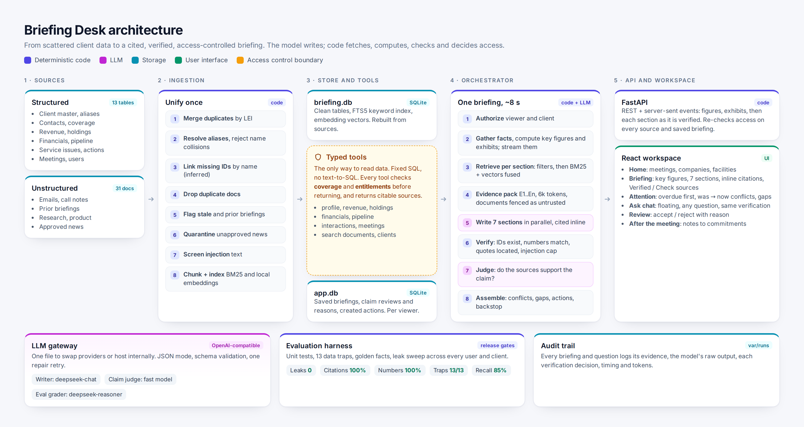
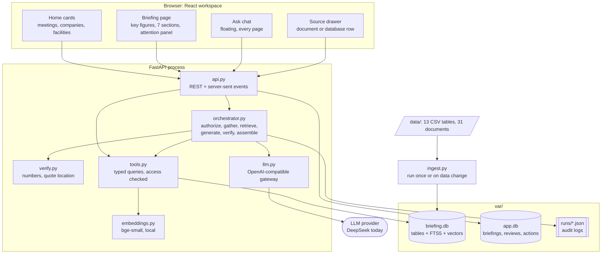
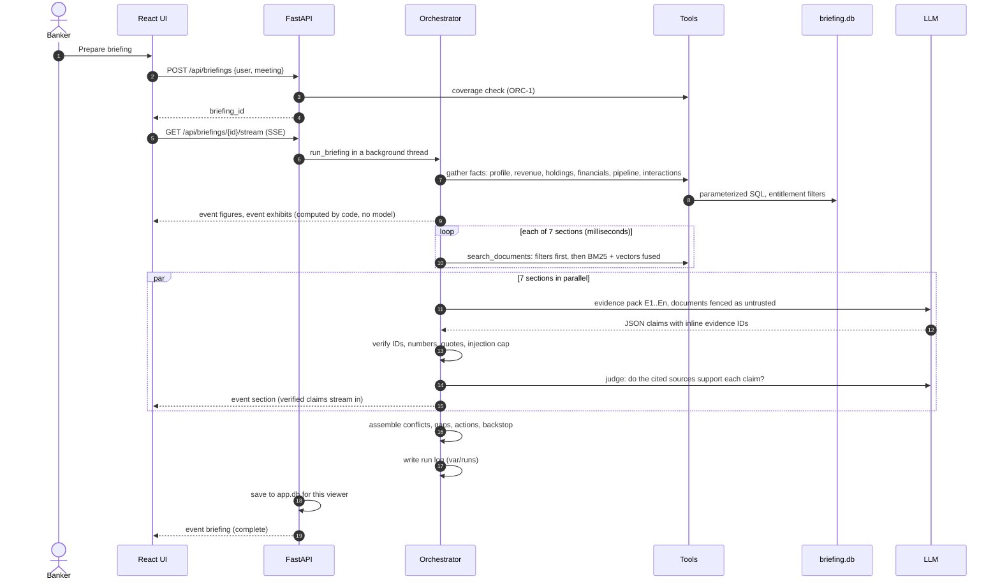
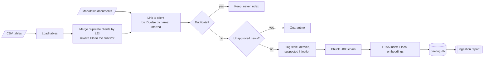
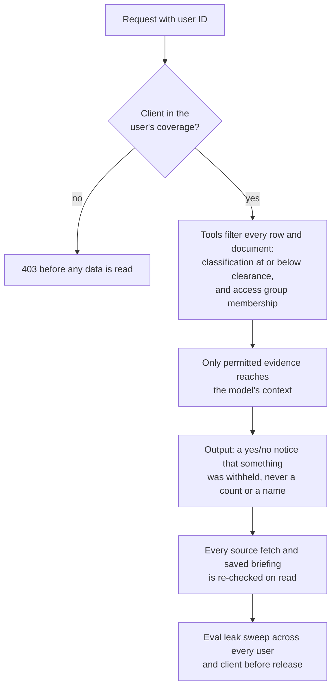

# Architecture

Source: [`images/architecture.html`](images/architecture.html), rendered to PNG. The diagrams below are
Mermaid, so they render on GitHub and stay editable as text.

The [design walkthrough](DESIGN.md) explains *why*; this page shows *what runs where*. Requirement
IDs point into [`specs/`](../specs/00-overview.md).

## Components

| Module | Responsibility | Specs |
|---|---|---|
| `ingest.py` | Load, unify, resolve, dedup, flag, screen, chunk, index; writes an ingestion report | ING-1..11 |
| `entities.py` | Name to client: exact, then guarded fuzzy matching | ING-3 |
| `tools.py` | The only data access layer: fixed SQL, entitlement and coverage checks, citable sources | TOOL-1..14, DATA-1/2 |
| `embeddings.py` | Local embedding model, loaded once per process | ING-10 |
| `orchestrator.py` | Briefing and question pipelines, key figures, exhibits, backstop | ORC-1..15 |
| `verify.py` | Quantity extraction and matching, quote location | ORC-6 |
| `prompts.py` | Every prompt in one reviewable file | ORC-5, ORC-6 |
| `llm.py` | One gateway: JSON mode, schema validation, one repair retry, usage accounting | |
| `api.py` | HTTP API, background briefing jobs, SSE, saved briefings and reviews | API-1..15 |
| `eval.py` | Evaluation harness and release gates | EVAL-1..11 |
| `frontend/src` | React workspace | UI-1..13 |

## One briefing, end to end

Typical timings: facts and cards in well under a second; the full briefing in about 8 seconds, almost
all of it the parallel model calls. A failing section is isolated and reported; the rest still arrive.

**The chat** (`POST /api/clients/{id}/ask`) runs the same path for one question: coverage check,
gather, retrieve with the question as the query, generate, verify. It returns a single answer instead
of streaming sections.

## Ingestion

Ingestion is deterministic and idempotent: running it again rebuilds `briefing.db` from `data/`.
User state lives in a separate `app.db`, so re-ingesting never loses saved briefings or reviews;
briefings prepared on older data are marked "Source data changed since this was prepared".

## Access control layers

Access is decided in code at every layer and never delegated to the model: it cannot leak what it
never receives, and it is not allowed to withhold what the viewer is cleared for.

## Storage

| Store | Contents | Lifecycle |
|---|---|---|
| `var/briefing.db` | Source tables after unification, document chunks, FTS5 index, embedding vectors | Rebuilt by ingestion |
| `var/app.db` | Saved briefings (per viewer), claim reviews with reasons, created actions | Persistent; never touched by ingestion |
| `var/runs/*.json` | Per briefing and per question: evidence, model output, verification decisions, timing, tokens | Audit trail |
| `var/eval/` | Eval results as JSON plus a markdown summary | Per eval run |
| `var/models/` | Embedding model cache | Downloaded on first run |

## API surface

| Endpoint | Purpose |
|---|---|
| `GET /api/users`, `GET /api/meetings`, `GET /api/home` | Profiles, upcoming meetings, dashboard cards |
| `POST /api/briefings`, `GET /api/briefings/{id}/stream` | Start a briefing; stream `figures`, `exhibits`, `section`, `briefing`, `error` |
| `GET /api/briefings/latest`, `/history`, `/{id}` | Saved briefings and versions, owner only, access re-checked |
| `GET /api/sources/{id}` | Full source for the drawer, access re-checked |
| `POST /api/briefings/{id}/claims/{claim}/review` | Accept, reject with reason, or undo |
| `POST /api/actions`, `POST /api/clients/{id}/notes` | Create follow-ups; extract commitments from notes |
| `POST /api/clients/{id}/ask`, `GET /api/clients/search` | Chat answers; client search by name or alias |
| `GET /api/health/data` | Ingestion report |

## Deployment

| | Prototype | Production direction |
|---|---|---|
| Process | One FastAPI process serves the API and the built UI (`./run.sh`) | Stateless API replicas behind the firm's gateway; briefing jobs on a queue |
| Data | SQLite files | Postgres (+ pgvector) or the firm's search platform; CDC connectors from source systems |
| Identity | Demo profiles | Firm SSO and entitlement service, information barriers for MNPI |
| Model | DeepSeek via an OpenAI-compatible gateway | Internally hosted or approved provider behind the same gateway, versions pinned |
| Audit | JSON run logs | Immutable audit store with retention policy |
