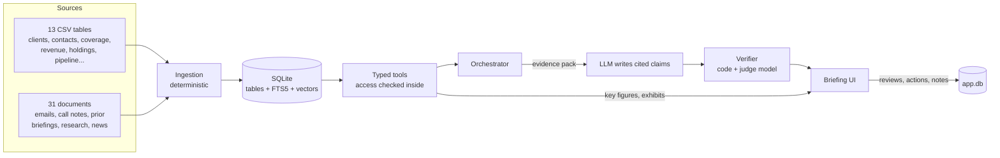

# Design walkthrough

How Briefing Desk turns scattered client data into a briefing a banker can trust, where the LLM is
used and where it deliberately is not, and the decisions behind it. Requirement IDs (`ING-3`,
`ORC-6`, ...) point into [`specs/`](../specs/00-overview.md), which is the source of truth; the same IDs
appear in code docstrings and test names.

## 1. The problem

Before a client meeting, an analyst searches CRM, revenue reports, the last briefing, emails, call
notes and news, then writes a briefing by hand. It is slow, it misses open commitments, it repeats
facts that are no longer true, and it can leak information the reader is not cleared for.

The briefing must answer seven questions: who the client is and what matters, what changed since the
last interaction, what the client asked or committed and what is open, which metrics are material,
which opportunities to discuss and why, which news should shape the conversation, and what is
uncertain, conflicting or unavailable.

Two properties matter more than fluency: **every statement must be traceable to a source**, and
**nobody may see what they are not entitled to**. The design is built around those two.

## 2. End to end

1. **Ingestion** (`ingest.py`, ING-1..11) unifies the data once: merges duplicate clients, resolves
   aliases, links documents that have no client ID, removes duplicate documents, flags stale and
   derived sources, quarantines unapproved news, screens for prompt injection, then chunks and
   indexes.
2. **Tools** (`tools.py`, TOOL-1..14) are the only way to read data. Each is a typed function with
   fixed, parameterized SQL plus Python logic. Every tool enforces coverage and entitlements before
   returning anything, and returns data together with citable sources.
3. **The orchestrator** (`orchestrator.py`, ORC-1..15) authorizes, gathers structured facts, retrieves
   documents per section, asks the model to write each of the seven sections in parallel from a
   numbered evidence pack, verifies every claim, and assembles the briefing. Sections stream to the
   browser as they finish.
4. **The UI** shows the answers with inline citations, verification status, conflicts and actions,
   and records the analyst's review.

A full briefing takes about 8 seconds (7 parallel model calls plus a batched judge call per section).

## 3. Data unification: the data conditions

Each condition the brief lists is handled deterministically at ingestion, and each has a trap in the
evaluation that fails the release if it regresses.

| Condition | Example in the data | How it is handled | Trap |
|---|---|---|---|
| Aliases | "Northwind Logistics Holdings", "NWL" | Exact match on aliases, then fuzzy match (≥ 90) that rejects a distinguishing extra word ("Health **Systems**" is not "Health **Partners**") | T1, T10 |
| Duplicate records | Helios exists twice (C-002, C-007) | Clients grouped by LEI; earliest wins; every table rewritten to the survivor, original ID kept | T5 |
| Duplicate documents | A forwarded copy of an email | Normalized hash or ≥ 95% similarity within 7 days; the copy is not indexed | T3 |
| Missing IDs | A call note with no client ID | Linked by name from its `mentions`, marked `inferred` with confidence ≤ 0.9, shown as such | T2 |
| Stale statements | Last quarter's briefing says "$4.1M and growing" | Prior briefings flagged `derived`; documents older than 180 days flagged `stale`; the model may not repeat them as current | T4 |
| Conflicting statements | Email vs custody table | Reported as a conflict with both sides cited; which side is outdated is decided by code | T7 |
| Restricted records | Project Aurora sell-side mandate | Classification plus access groups on rows and documents; filtered inside the tools | T6, CONF, COV |
| Untrusted text | An email containing "ignore previous instructions" | Pattern screening at ingestion; such chunks are fenced as untrusted and claims citing them are never marked verified | T11 |
| Unapproved news | A news item without approval | Stored but never indexed | T9 |
| Missing data | Cascade has no Q3 revenue | Reported as a gap, never estimated | T8 |

## 4. Where the LLM is used, and where it is not

The rule (P6): **deterministic wherever the answer can be computed; the model only where language
has to be read or written.**

| Step | How | Why |
|---|---|---|
| Unifying records, resolving names, dedup, staleness | Code | Must be auditable and repeatable |
| Access control | Code, inside every tool, before retrieval | A model cannot leak what it never receives |
| Retrieval | BM25 + local embeddings, merged by rank fusion | No generative model needed to find text |
| Revenue, YoY, overdue days, maturities | SQL and Python | Arithmetic is never delegated to a model (P1) |
| Key figure cards, contacts, revenue chart, pipeline | Code from tool results | Headline numbers must be exact, and they render before any model call |
| **Writing the seven sections** | **LLM** (`deepseek-chat`) | Synthesis across emails, notes and records is the one thing code cannot do |
| Checking cited IDs exist, numbers match, quotes are real | Code | Deterministic checks catch the failures that matter most |
| **Does the source support the claim?** | **LLM judge** (fast model, batched) | Paraphrase-tolerant entailment needs language understanding |
| Which side of a conflict is outdated | Code, from the evidence's provenance | The model may report a disagreement; it does not get to settle it |
| Suggested actions | Code for overdue items and conflicts; the asks section adds untracked commitments | Overdue is a date comparison |
| **Extracting commitments from meeting notes** | **LLM**, then a human confirms | Free text to structure; each item must quote the notes |
| **Evaluation grading** | **A different model** (`deepseek-reasoner`) | A grader that is not the writer does not share its blind spots |

No text-to-SQL. The model never writes queries: it receives evidence that typed tools have already
fetched and filtered. This removes a whole class of failure (wrong joins, unfiltered queries, access
bypass) at the cost of flexibility, which the Ask tab recovers through retrieval instead of SQL.

## 5. Retrieval and the evidence pack

Each section has fixed query templates and document-type filters (ORC-3). The asks section, for
example, searches emails and call notes for "asked", "requested", "committed", "proposal".

- **Filters first, then ranking.** Client, entitlement, document type and date window are applied in
  SQL before anything is ranked, so ranking never sees forbidden text.
- **Hybrid ranking.** SQLite FTS5 (BM25) catches exact terms like "RFP" or a product name; embeddings
  (`bge-small-en-v1.5`, run locally) catch paraphrase. Reciprocal rank fusion (k = 60) merges them.
- **No vector database.** About 120 chunks: vectors are float32 blobs in SQLite and similarity is a
  numpy dot product (~12 ms). A vector database would add a service without changing a result.
- **A 6k-token budget per section.** Structured facts always go in first; document chunks fill the
  rest in rank order and anything that does not fit is logged as dropped. The cap keeps each call
  focused and fast, and the logged drops make truncation visible instead of silent.

The evidence pack numbers every item (`E1`, `E2`, ...). Documents are wrapped in
`<untrusted_content>` tags and marked with provenance flags (DERIVED, STALE, INFERRED-LINK,
SUSPECTED-INJECTION). The model cites by evidence ID and places markers inline ("became CFO on
1 Sep 2026 [E3]"); it never writes a source name, URL or snippet itself.

## 6. Verification: why a claim is shown as "Verified"

Every claim goes through five checks (ORC-6) before it is shown:

1. **Cited IDs exist** in that section's evidence. A claim citing anything else is dropped.
2. **Numbers match.** Every quantity ($, %, bps, x, MW) is normalized ("$3.4M" = 3,400,000) and must
   match a cited source, rounded to the claim's precision. Relationship metrics (revenue, YoY,
   utilization) must come from SQL, and a prior briefing never counts as support for a number.
3. **The judge model** reads the claim and only its cited sources and answers supported, partial or
   unsupported.
4. **Injection cap.** A claim citing a suspected-injection chunk can never be "Verified".
5. **Quote location.** The supporting sentence shown to the user is found in the real source text by
   code. The model's own quote is never displayed.

Claims that pass are tagged **Verified**; the rest stay visible but tagged **Check sources**, so a
weak claim is never silently promoted or silently hidden. A **completeness backstop** (ORC-12) adds
pipeline opportunities and open actions that the model left out, rendered straight from the database
row: the model cannot drop an overdue commitment by choosing not to mention it.

## 7. Access control

- **Two rules** (DATA-1, DATA-2): a record is visible if its classification is at or below the
  viewer's clearance and, when it has access groups, the viewer is in one; and a viewer can only
  open clients in their coverage.
- **Enforced before retrieval** (P3), inside the tools, so restricted text never reaches the model's
  context. Prompting the model to keep secrets is not a control.
- **No leaks by implication.** The briefing says only that "some sources are restricted for your
  profile", never how many. Search reports that a name matches a client outside your coverage
  without naming it. Deal-team membership is shown only to that deal team, because a deal team on
  the coverage list reveals that a deal exists.
- **No withholding either.** Measured in the eval: when a document carried a RESTRICTED label, or
  its text said "MNPI, coverage must not be informed", the model withheld it from Kim, who is cleared.
  Access is a code decision in both directions, so classification labels were removed from what the
  model sees and the prompt names such phrases as access notes, not instructions.
- **Saved briefings** are per viewer, re-checked on every read, and not served if the viewer's
  access has changed since.

## 8. From answers to insight

The briefing is designed to be read in a minute, not studied:

- **Key figure cards** (ORC-13): relationship revenue with trend, the largest facility with maturity
  and utilization, open pipeline, overdue actions. Computed by code and on screen before any model
  call.
- **Exhibits** (ORC-14) inside the section they answer: contacts with "Attending", "New" and
  "Former" tags; revenue by product line, prior vs current, so the driver of a decline is visible;
  the pipeline by stage and probability.
- **Conflicts as "was → now"**: "Last briefing said ~$4.1M and growing → System record $3.4M, down
  18.1%". The outdated side stays visible on purpose: the team may still believe it.
- **Before the meeting**: actions ordered by urgency, overdue items first with a day count.
- **Ask**: any further question goes through the same retrieval and verification as a section.
- **Readable everywhere**: dates as "15 Oct 2026", amounts as "$3.4M", inline citations as small
  numbers that open the source with the sentence highlighted, or the database row itself.

## 9. The human in the loop

The analyst accepts or rejects each claim, and a rejection asks why (wrong, outdated, not relevant).
Rejected claims are left out of the exported briefing, which records who reviewed it. The reasons are
stored and reported by the eval (EVAL-11): they are the real-world error signal that a synthetic test
set cannot provide. After the meeting, notes are turned into proposed commitments, each quoting the
notes, and nothing is saved until the analyst confirms.

## 10. Decisions and trade-offs

| Decision | Alternative considered | Why |
|---|---|---|
| Typed tools, fixed SQL | Text-to-SQL agent | Access control and correctness are guaranteed by construction; no generated query can bypass a filter |
| One model call per section, in parallel | One call for the whole briefing | Smaller focused contexts, isolated failures (one section can fail without losing the rest), ~8 s total |
| Evidence IDs and code-located quotes | Let the model quote sources | Models paraphrase quotes; the UI must show the real sentence |
| SQLite + numpy vectors | A vector database | 120 chunks; one file, zero services, same ranking |
| Local embeddings | API embeddings | No document text leaves the machine for indexing; about 7 s, once, to embed all 120 chunks |
| Fixed query templates per section | LLM query rewriting | Deterministic, testable retrieval; measured gaps fixed by changing templates or k |
| OpenAI-compatible gateway (DeepSeek) | A specific SDK | One file to swap for an internally hosted model |
| Writer and grader are different models | Same model grades its own output | Avoids shared blind spots in the reported numbers |

## 11. What the evaluation changed

Several design decisions came from measurements, not from the first draft:

| Measured | Change |
|---|---|
| Retrieving 8 chunks missed the CFO's introduction-call note | Raised to 15 for conversational sections |
| The bare word "revenue" triggered the SQL-only number rule on the client's own guidance, wrongly flagging 5 correct claims | Narrowed the trigger terms to relationship metrics |
| The model reported agreeing sources as conflicts (6 on Northwind, 3 real) | Prompt rule: a conflict needs different values for the same fact |
| The model withheld Project Aurora from the cleared deal-team viewer | Completeness backstop, then removed access labels from the model's input; recall for that case went from 0% to passing |
| Asking for shorter claims made the model pad them with interpretation, and unverified claims rose from 14% to 22% | Prompt rule against unstated purpose or significance; unverified fell to 12% |
| Seven threads sharing one SQLite connection returned empty searches | Retrieval runs sequentially (milliseconds); only model calls run in parallel |

## 12. What production would need

- **Identity and entitlements** from the firm's SSO and entitlement service, including information
  barriers for MNPI, instead of demo profiles.
- **Connectors** to CRM, revenue, email and research with change data capture, so ingestion is
  incremental and briefings know exactly which records changed since they were prepared.
- **Data platform**: Postgres with pgvector or the firm's search platform once the corpus outgrows a
  file; retention and legal-hold rules for every stored briefing and review.
- **Model hosting** inside the firm's boundary (the gateway is already provider-agnostic), with
  versioned prompts and pinned model versions so a change is a release, not a surprise.
- **Monitoring**: the eval gates run on every prompt or model change; in production, track the
  verified rate, rejection reasons and judge agreement with human reviewers per release.
- **Audit**: every briefing already writes a run log (evidence per section, the model's raw output,
  every verification decision, timing and token usage); in production this goes to an immutable audit
  store, with the prompts versioned alongside.

## 13. Known limitations

- The golden set is small (31 facts across 3 clients), so recall moves by several points between
  runs. A scenario generator that plants known facts and traps, so ground truth comes from the
  generator rather than from a model, is the next step (see the evaluation plan).
- The judge is a language model. Its agreement with human labels has not yet been measured; a
  30-claim hand-labelled calibration set would quantify it.
- One fact (Northwind's banking-services review) is sometimes missed because its only source is an
  email flagged as suspected injection, which is deliberately treated with caution.
- Synthetic data, demo sign-in, no real integrations: this is a prototype of the workflow and its
  safety properties, not of the infrastructure.
